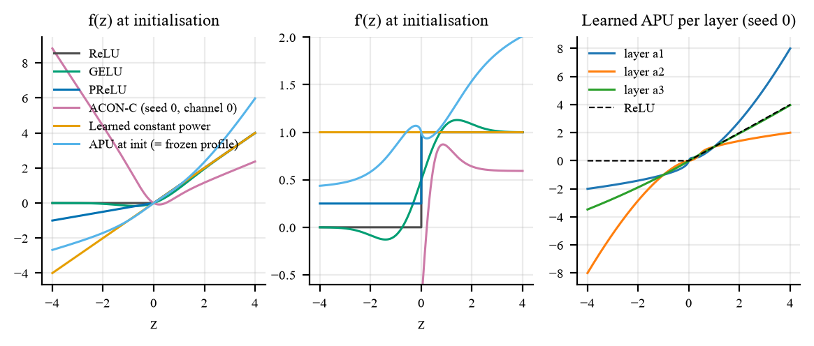
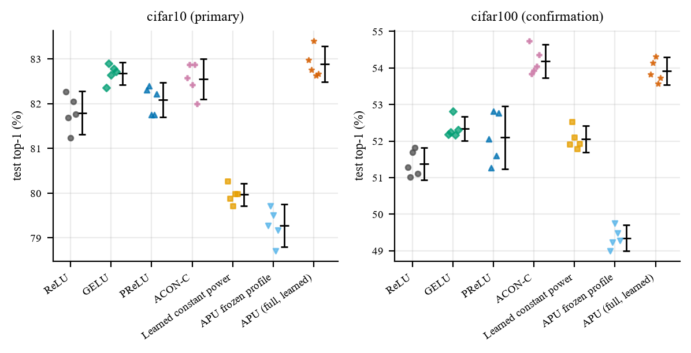
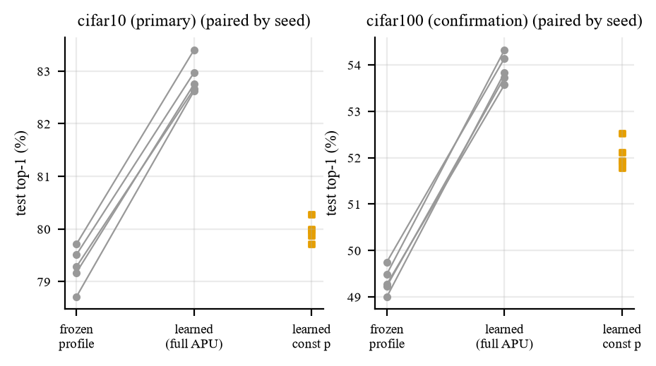

# Adaptive Power Units: Learning Bounded, Input-Dependent Activation Functions for Image Classification

Adaptive Power Units (APUs) are activation functions that learn their own shape. Each input generates its own exponent through a bounded, learned map, and a smoothed signed power turns that exponent into the response:

$$
A = a_{\max}\tanh(a), \qquad p(z) = p_0 + A\tanh(wz + b), \qquad f(z) = z\,(z^2 + \epsilon)^{(p(z)-1)/2}
$$

Each activation layer learns only three scalars, $a$, $w$ and $b$. With $p_0 = 1$, $a_{\max} = 0.5$ and $\epsilon = 10^{-3}$, the exponent always stays between 0.5 and 1.5, so the unit can compress or amplify responses depending on their size while keeping the sign of every input.

This repository contains the full implementation, the complete experiment record and the analysis behind the paper. Every number below is regenerated from the stored records.

## Highlights

- **Learning the exponent pays off.** Full APU improves on its own frozen starting shape by **3.60 points on CIFAR-10** and **4.57 points on CIFAR-100** (both p < 0.001). With identical optimizer settings, the gain is 3.86 points.
- **Highest CIFAR-10 accuracy under equal tuning: 82.88%**, ahead of GELU, ACON-C, PReLU and ReLU.
- **Beats GELU on CIFAR-100 by 1.58 points** (95% CI [1.01, 2.15], Holm-adjusted p = 0.0035).
- **ACON-C-level accuracy with 75 times fewer parameters:** 9 learned scalars against 672.
- **Robust to the training recipe:** 82.94% with a shared recipe and 82.88% after tuning, while GELU needs tuning to gain 0.85 points.
- **Learned input dependence beats a learned constant exponent** by 2.91 points on CIFAR-10 and 1.86 on CIFAR-100.
- **Smaller train–validation gap than every baseline:** 11.30 points against 14.50 for GELU on CIFAR-10, and 20.06 against 26.31 on CIFAR-100.
- **Efficient when compiled:** an APU training epoch is only 18% slower than ReLU with `torch.compile`, in line with ACON-C (17%).

## What makes APU different

| Property | APU |
|---|---|
| Exponent | Generated from each input value, bounded to (0.5, 1.5) by construction |
| Parameters | 3 per activation layer, shared over channels and positions (9 in total for the shallow CNN) |
| Signed inputs | Handled by a smoothed positive base, no piecewise branch: $f(0) = 0$ and the sign of every input is preserved |
| Smoothness | Smooth for any finite parameters; recovers the identity exactly at $p_0 = 1$, $A = 0$ |
| Geometry | Every learned profile passes through fixed anchors at $z = 0$ and $z = \pm\sqrt{1-\epsilon}$, which makes learned shapes directly comparable |
| Numerics | Exponent and power computed in float32, also under bfloat16 mixed precision |
| Interpretability | The learned exponent profile of every layer can be plotted and inspected |

Earlier work learned signed-power exponents per channel or generated them from feature statistics (Sun et al., CVPR 2018), and PowLU (2026) uses an input-dependent rational exponent inside a language-model gate. APU's distinction is a bounded exponent computed locally from each scalar, with a learned amplitude, three module-shared parameters and a smoothed sign-preserving base.



## The study at a glance

| | |
|---|---|
| Training runs | 189 fits, 37,800 epochs, about 35 GPU hours on an NVIDIA RTX 5070; no run diverged |
| Methods | 7: ReLU, GELU, PReLU, ACON-C, and APU with two purpose-built controls (frozen shape, learned constant exponent) |
| Equal hyperparameter search | 84 fits: the same 6 settings, 2 selection seeds and 200 epochs for every method |
| Final evaluation | 105 fits: 5 new seeds per method on CIFAR-10 (tuned and shared recipe) and on CIFAR-100 |
| Predeclared protocol | Protocol frozen before the search, CIFAR-100 declared as the confirmation dataset in advance, selections locked before final training, each final fit tested exactly once |
| Paired design | Identical starting weights, data order and augmentation across methods for every seed |
| Correctness checks | 31 automated checks before training, including float64 gradient checks and bit-exact resumption |
| Reproducibility | SHA-256 fingerprint for every run configuration and for the training code |
| Cost measurement | 42 benchmarks in fresh processes, eager and compiled, 3 interleaved rounds |
| Diagnostics | Per-layer activation, exponent and gradient statistics at 7 points in training |
| Audit | The earlier exploratory study (483 runs) archived, checksummed and reconciled |

## Main results

Final-epoch test top-1 accuracy (%), mean ± sample SD over 5 seeds, shallow CNN, 200 epochs.

| Method | Learned activation scalars | CIFAR-10 (primary) | CIFAR-100 (confirmation) | CIFAR-10, shared recipe |
|---|---|---|---|---|
| ReLU | 0 | 81.79 ± 0.39 | 51.38 ± 0.36 | 81.52 ± 0.30 |
| GELU | 0 | 82.67 ± 0.20 | 52.34 ± 0.27 | 81.82 ± 0.53 |
| PReLU | 3 | 82.08 ± 0.31 | 52.10 ± 0.69 | 81.71 ± 0.12 |
| ACON-C | 672 | 82.55 ± 0.36 | **54.18 ± 0.37** | 81.64 ± 0.11 |
| Learned constant power | 3 | 79.97 ± 0.20 | 52.05 ± 0.29 | 79.85 ± 0.16 |
| Frozen APU | 0 | 79.28 ± 0.38 | 49.35 ± 0.28 | 79.08 ± 0.26 |
| **Full APU** | **9** | **82.88 ± 0.32** | 53.92 ± 0.31 | **82.94 ± 0.35** |



Paired differences, Full APU minus each method (percentage points, 95% confidence interval, Holm-adjusted p for secondary comparisons):

| Full APU minus | CIFAR-10 | CIFAR-100 |
|---|---|---|
| Frozen APU | **+3.60** [3.35, 3.86], p < 0.001 | **+4.57** [4.26, 4.88], p < 0.001 |
| Learned constant power | **+2.91** [2.39, 3.44], p < 0.001 | **+1.86** [1.24, 2.49], p = 0.0035 |
| GELU | +0.21 [−0.40, 0.81], p = 0.398 | **+1.58** [1.01, 2.15], p = 0.0035 |
| ACON-C | +0.33 [−0.08, 0.74], p = 0.176 | −0.26 [−1.04, 0.52], p = 0.401 |



## Execution cost

Medians of three fresh-process rounds, batch 128, NVIDIA RTX 5070, bfloat16 autocast.

| Mode | Method | Step (ms) | Epoch (s) | Peak memory (MiB) |
|---|---|---|---|---|
| Eager | ReLU | 3.05 | 1.44 | 142.79 |
| Eager | GELU | 3.04 | 1.47 | 161.94 |
| Eager | ACON-C | 5.42 | 2.31 | 290.24 |
| Eager | Full APU | 7.32 | 2.91 | 494.93 |
| Compiled | ReLU | 2.78 | 1.39 | 117.73 |
| Compiled | GELU | 2.98 | 1.39 | 144.66 |
| Compiled | ACON-C | 3.55 | 1.63 | 232.52 |
| Compiled | Full APU | 3.68 | 1.64 | 195.77 |

Compilation cuts APU's epoch overhead from 102% to 18% and its memory overhead from 247% to 66%, using less peak memory than ACON-C. Compiled inference at batch 128 takes 0.60 ms for both APU and ReLU.

## Repository layout

```
Adaptive-Power-Units/
├── APU_v2.ipynb          the study notebook (settings, launch, analysis); outputs included
├── apu_lib/              library code, written by the notebook (12 modules)
├── apu_v2_runs/          the complete run record, unchanged since the run
│   ├── configs/          one immutable configuration per run, named by its digest
│   ├── runs/             run records (status, history, diagnostics) and one-time test results
│   ├── protocol/         protocol.json (frozen before the search) and lock.json (before final fits)
│   ├── splits/           validation split indices with checksums
│   ├── engineering/      results of the 31 pre-training checks
│   ├── benchmarks/       cost measurements, one file per process
│   ├── audit/            audit of the historical study
│   ├── logs/             one environment record per session
│   └── paper_assets/     tables, figures, CLAIMS.md, CHECKLIST.md
├── experiments/          one CSV per stage: search, primary, confirmation, common_recipe
├── results/              copy of paper_assets for browsing
├── historical/           the earlier exploratory study (APU_Final2) and its records
├── scripts/              build_indexes.py regenerates experiments/ and results/
└── docs/                 methodology.md, reproducibility.md
```

Runs are stored by configuration digest, not by stage, because a run can belong to more than one stage. `experiments/*.csv` gives the stage view.

## Setup

Tested on Windows 11 with an NVIDIA GeForce RTX 5070 (12 GB), Python 3.12.10, PyTorch 2.11.0 and CUDA 12.8.

```
python -m venv .venv
.venv\Scripts\activate          # Linux/macOS: source .venv/bin/activate
pip install torch==2.11.0 torchvision==0.26.0 --index-url https://download.pytorch.org/whl/cu128
pip install -r requirements.txt
```

## Running the study

1. Open `APU_v2.ipynb` in Jupyter, set `PROFILE = "smoke"` in the first code cell and run all cells. This tests the whole pipeline on synthetic data in about 10 minutes and writes only to `apu_v2_smoke/`.
2. Set `PROFILE = "paper"` and run all cells again. CIFAR-10 and CIFAR-100 are downloaded to `data/` and checked before any training.

The full run took about 35 hours on the RTX 5070. If it stops, running all cells again resumes from the last saved epoch, and completed runs are reused. With the existing `apu_v2_runs/` in place, the notebook reuses every run and only rebuilds the analysis.

The historical audit expects the old study in the folders named in the settings cell. In this repository they are under `historical/`, so set `OLD_ROOT = Path("historical/apu_runs_paper")` and `OLD_NOTEBOOK = Path("historical/APU_Final2.ipynb")` before rerunning.

To refresh the stage CSVs and the `results/` copy:

```
python scripts/build_indexes.py
```

## Checkpoints

The final checkpoints (about 1.2 GB) are not in the repository. Download `checkpoints.zip` from the Releases page and unzip it into `apu_v2_runs/checkpoints/`. They are only needed to re-evaluate models; the test results are already recorded in `apu_v2_runs/runs/*.test.json`.

## Documentation

- [docs/methodology.md](docs/methodology.md): the activation, controls, model, training, search, locking, statistics and decision rules.
- [docs/reproducibility.md](docs/reproducibility.md): environment, determinism, run identities, the order of protocol steps, and how to verify the record.

## License

See [LICENSE](LICENSE).
